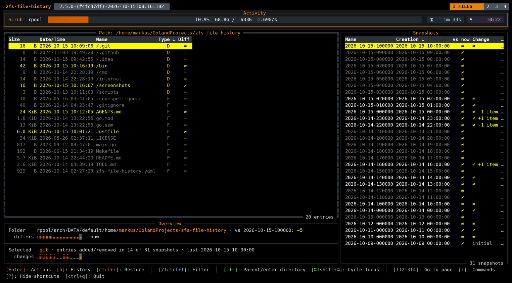

<h1 align="center">zfs-file-history</h1>
<h4 align="center">Terminal UI for inspecting and restoring file history on ZFS snapshots.</h4>

<div align="center">

[]()
[](https://github.com/markusressel/zfs-file-history/releases)
[](/LICENSE)



</div>

# Features

* [x] Terminal based file browser for your datasets
* [x] File history
  * [x] Find the snapshots in which a file was changed
  * [x] Diff against the previous version or your local file
  * [x] Restore files and folders from any snapshot
* [x] Folder history, including size and item count over time
* [x] Snapshot management (create, clone, destroy, hold)
* [x] Dataset overview
  * [x] Tree view
  * [x] Space usage breakdown
  * [x] Edit properties
  * [x] Manage delegated permissions
* [x] Pool health and `zpool status`
* [x] Progress of running scrubs, resilvers, TRIMs and other pool operations on every page
* [x] Alerts on every page when a pool has problems (data errors, degraded, failing devices)
* [x] Disk temperatures and SMART health of the disks of all pools, without waking sleeping disks
* [x] Damaged files (data errors) marked in the file and snapshot browsers, including the snapshots holding them
* [x] Start, pause and cancel scrubs and TRIMs, clear pool errors
* [x] History of pools and datasets (`zpool history`): what was done, when and by whom, including destroyed snapshots,
  grouped into scrubs, resilvers, TRIMs and runs of commands
* [x] Live updates using zpool events
* [x] Filter, sort and configure the columns of all lists
* [x] Copy any text with the mouse (drag, or double-click a word), also over SSH (needs a terminal with OSC 52)
* [x] Remembers your last session

All important shortcuts are shown at the bottom of the screen, press `:` to see everything else.

# How to use

```shell
# Open the current directory
zfs-file-history
# Open a specific directory
zfs-file-history /path/to/folder
```

## Installation

### Arch Linux 

```shell
yay -S zfs-file-history-git
```

<details>
<summary>Community Maintained Packages</summary>

None yet

</details>

### Manual

Compile yourself:

```shell
git clone https://github.com/markusressel/zfs-file-history.git
cd zfs-file-history
make deploy
```

## One Time Setup

### Root Permissions

Some features need `zpool` and `smartctl` commands that only root may run, ZFS cannot delegate them like dataset
permissions:

- **Live updates** (`zpool events`): new snapshots and changes of the pools show up right away.
- **Damaged files** (`zpool status -v`): which files are damaged by data errors.
- **Pool history** (`zpool history -il <pool>`): what was done to the pools and datasets, when and by whom.
- **Disk health** (`smartctl`, if smartmontools is installed): the SMART values of the disks of the pools.
- **Pool actions** (`zpool scrub`, `trim`, `clear`): scrubs, TRIMs and clearing the errors of a pool. Destroying,
  exporting or upgrading pools is not offered by zfs-file-history at all.

On the first start, zfs-file-history offers to allow them for your user (also later with "Set up permissions" in the
command menu): it runs its setup command with sudo, which creates sudoers rules that let your user run exactly these
commands without a password. The setup can also be run by hand; it asks for each rule, or takes them as flags:

```shell
sudo zfs-file-history setup
sudo zfs-file-history setup --events --data-errors --history --smart --pool-actions
```

### Permissions

If a ZFS permission (delegation) is missing, zfs-file-history automatically gives you the option to add the missing permission to the relevant dataset for your user.

However, if you want to give these permissions in one swoop you can also run this one line:

```shell
sudo zfs allow $USER mount,snapshot,destroy,hold,release <dataset>
```

## Configuration

> **Note:**
> The configuration is optional. It contains display and behavior settings of the file browser,
> as well as debugging settings.

Then configure zfs-file-history by creating a YAML configuration file in **one** of the following locations:

* `/etc/zfs-file-history/zfs-file-history.yaml` (recommended)
* `/home/<user>/.config/zfs-file-history/zfs-file-history.yaml`
* `./zfs-file-history.yaml`

```shell
mkdir -p ~/.config/zfs-file-history
nano ~/.config/zfs-file-history/zfs-file-history.yaml
```

### Example

An example configuration file including more detailed documentation can be found
in [zfs-file-history.yaml](/zfs-file-history.yaml).

## State

Besides the configuration file, which is only ever written by you, zfs-file-history remembers some UI settings
(like the columns and sort order of the tables) and your last session in a state file:

* `$XDG_STATE_HOME/zfs-file-history/state.json`, by default `~/.local/state/zfs-file-history/state.json`

Deleting it resets all remembered settings. If you don't want to continue where you left off, start with `--fresh`.

# Dependencies

See [go.mod](go.mod)

# Similar Projects

* [zfs-snap-diff](https://github.com/j-keck/zfs-snap-diff)
* [snapshot-explorer](https://github.com/atheriel/snapshot-explorer)

# License

```
zfs-file-history
Copyright (C) 2023  Markus Ressel

This program is free software: you can redistribute it and/or modify
it under the terms of the GNU Affero General Public License as published
by the Free Software Foundation, either version 3 of the License, or
(at your option) any later version.

This program is distributed in the hope that it will be useful,
but WITHOUT ANY WARRANTY; without even the implied warranty of
MERCHANTABILITY or FITNESS FOR A PARTICULAR PURPOSE.  See the
GNU Affero General Public License for more details.

You should have received a copy of the GNU Affero General Public License
along with this program.  If not, see <https://www.gnu.org/licenses/>.
```
